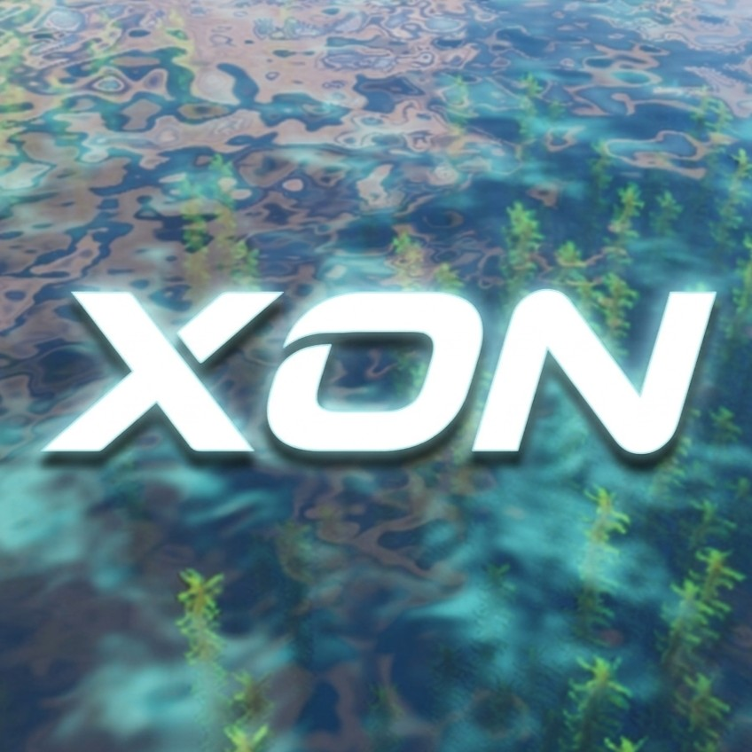
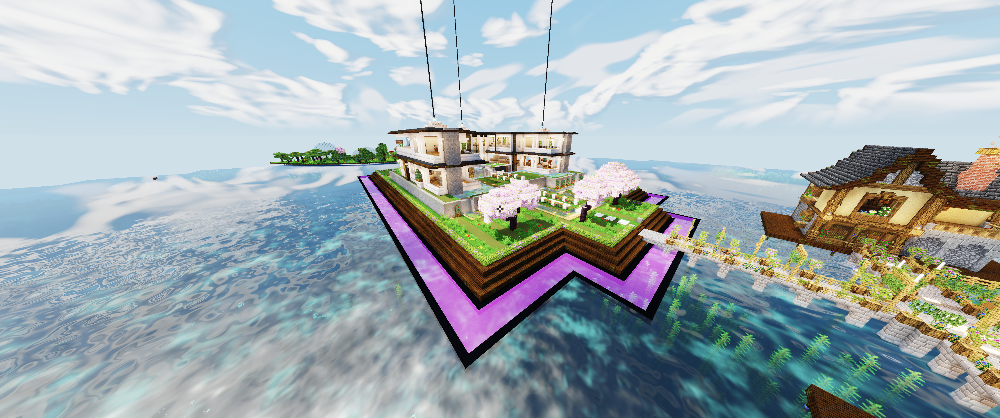
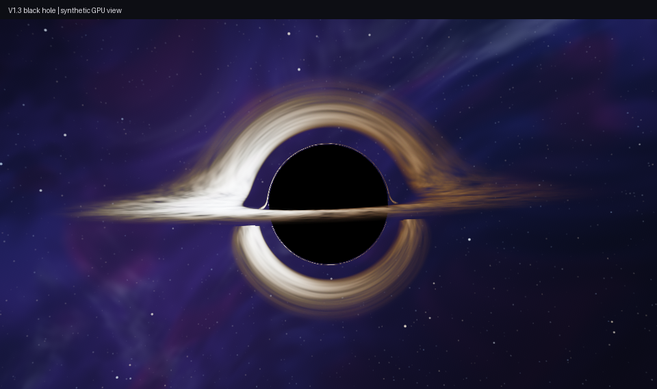
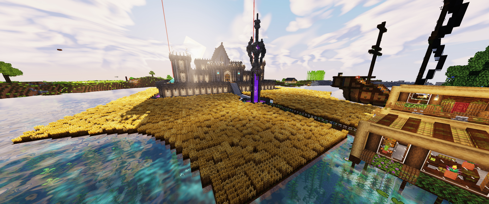

<p align="center">
  
</p>
<h1 align="center">XON Shader</h1>
<p align="center"><strong>Warm light. Clear water. A world in motion.</strong></p>
<p align="center">An Iris shader pack for Minecraft: Java Edition.</p>
<p align="center">
  <a href="#install">Install</a> ·
  <a href="CHANGELOG.md">Changelog</a> ·
  <a href="docs/releases/1.8.1.md">1.8.1 release notes</a> ·
  <a href="https://github.com/Danonymos/XON/issues/new/choose">Report an issue</a>
</p>
<p align="center">
  
  
  <a href="LICENSE"></a>
  <a href="https://github.com/Danonymos/XON/actions/workflows/build.yml"></a>
</p>



XON brings warm sunlight, cool readable shade, moving cloud shadows and glowing
ore light to your worlds. Water stays clear, the atmosphere changes throughout
the day, and edges receive built-in smoothing. Native resolution is the default.

The gallery uses existing XON gameplay captures. It illustrates the pack's visual
direction; it is not a controlled comparison or proof of the latest fixes.

## What's new in 1.8.1

**A more atmospheric End.** Lavender environmental light gives islands and
structures more character, with violet-magenta haze that gathers around island
height and drifts gently through the distance. Nearby surfaces stay clear,
while the galaxy, stars and black hole retain their existing appearance.

The effect uses the existing **Atmosphere Density** and **Fog Density** controls
under **Sky & Atmosphere**, without adding render passes, texture reads or buffers.
Overworld, Nether and the optimized 1.8 lamp system retain their current behavior.
See the [1.8.1 notes](docs/releases/1.8.1.md) and
[End atmosphere checks](docs/end-atmosphere-validation.md).

## What's new in 1.8

**Distinct light sources, smooth pools and more space for shade.** Lamps and
glowing plants now have their own colors, strengths and ranges. Their local
light replaces much of the broad warm fill, with readable ambient light between
sources and bright lamp cores.

- Soft mint lichen and compact orange berries; amber lanterns and yellow torches;
  cyan-white sea lanterns, white end rods and blue soul lights.
- Candle counts, wet sea-pickle counts, anchor charges and copper weathering
  select different profiles. Unlit switches retain their ordinary unlit state.
- Ore transport and controls remain separate. The 1.7 partial-block contact-shadow
  correction, warmer outdoor palette and darker outdoor nights are retained.
- Corrected thin-surface light sampling removes carpet-edge bands and decorative
  self-light patches. Final tuning lowers lamp spill by 15% and deepens indoor
  gap fill by up to 15%, preserving bright cores and open outdoor sunlight.
- One existing compute dispatch, with a separate lamp history pair and eight
  additional surface-volume fetches. Colored Light is required; Speed keeps the
  scalar fallback. No individual ray-traced lamp shadows are added.
- Shared light evaluation and a small per-frame contact cache reduce repeated
  shading work while preserving the 1.8 lighting. See the
  [optimization measurements](docs/lighting-optimization.md) for cost and output checks.

See the [1.8 notes](docs/releases/1.8.md),
[Modrinth changelog](docs/releases/1.8-modrinth.md) and
[lamp validation](docs/lamp-lighting-validation.md) for measured costs and limits.

## Retained from 1.7

**More depth in indoor lighting, with cleaner contact shadows.** Lamp-lit rooms
gain stronger face contrast and soft shade around solid walls, beams and corners.
Lamp strength, light propagation ranges and the warm XON palette are retained.

- **Shape-aware contact shade.** Only verified full-cube blockers contribute to
  the additional local occlusion. Partial and unknown shapes keep their existing
  light-propagation behavior without casting false full-block contact shadows.
- **Cleaner floors, walls and ceilings.** Sampling starts outside the receiver's
  coarse cell, correcting blotchy self-shadow patterns on carpet, slabs and inset
  surfaces. This correction applies across face directions.
- **Consistent lighting.** Ordinary lamps and colored spill share face contrast.
  Emissive cores, foliage, night vision and open outdoor lighting retain their
  intended response. The additional geometry occlusion needs Colored Block Light;
  Speed retains its lighter rendering path.

See the [release notes](docs/releases/1.7.md),
[Modrinth changelog](docs/releases/1.7-modrinth.md) and
[verification record](VERIFICATION.md). The final shape correction has GPU
regression coverage; its live Minecraft visual recheck remains outstanding.

## Retained from 1.6: smoother block edges

Temporal anti-aliasing uses eight subpixel
jitter positions, checked frame history and a sharp cubic reconstruction. No DLSS,
DLAA, RTX hardware or additional mod is required for this AA implementation.

Choose **Camera & Detail → Anti-Aliasing → Temporal**; Balanced, Vibrant and
Cinematic select it. **Fast** is a lighter spatial fallback selected by Speed.
**Off** is available for comparisons or external AA. Start with **Native** resolution
and external upscaling disabled to evaluate XON's AA by itself.

Temporal AA accompanies the new indoor shading while retaining PBR and POM.
Synthetic edge comparisons improve
on average, but some moving angles still favor the old spatial filter. Live play,
ghosting, texture sharpness and AMD/Intel hardware testing remain outstanding.
See the [test notes](docs/releases/1.6-test.md) and [verification record](VERIFICATION.md).

## What's new in 1.5

**More surface depth, cleaner materials and balanced brightness.** V1.5 adds optional
LabPBR 1.3 and OldPBR support for resource packs such as Primes HD Textures, while
keeping the warm colors and atmospheric effects introduced in 1.4.

- **Materials with depth.** Normal mapping, material ambient occlusion and POM reveal
  bark grooves, stone joints and other relief where the resource pack supplies height data.
- **Cleaner parallax.** Filtered height/color sampling, adaptive tracing and refined
  intersections reduce ridge striping. Atlas bounds and distance/grazing fades keep
  displacement controlled.
- **Restrained highlights.** GGX sun/moon highlights follow material reflectance,
  skylight and shadows. Non-emissive surfaces retain their lighting and corner shading.
- **Quieter brightness, familiar colors.** Lower base exposure is calibrated against
  1.3 while preserving 1.4's sunlight palette, grading texture, gradients and atmosphere.
- **Optional PBR.** Enable **Shader Settings → Materials & PBR → Advanced Materials**
  with a compatible resource pack. It defaults to Off; Cinematic enables it. PBR
  texture sampling is compiled out when disabled, and enabling it adds GPU work.

## What's new in 1.4

**Atmospheric vibe, volumetric light shafts and richer shadow works.** V1.4 overhauls
sunlight shafts and atmospheric depth while keeping XON crystal clear, sharp and fast.

- **Wrapping volumetric light shafts.** A dual-lobe Henyey-Greenstein + Rayleigh scattering
  model allows sunlight rays to wrap, stream and cast dramatic silhouettes around buildings
  and rooftops when backlit, even when the sun is occluded. 10 exponential steps with height
  density clustering give silky smooth shafts with near-zero overhead.
- **Edge-preserving bilateral filter.** An 8-tap bilateral depth filter in composite1
  prevents light shafts from bleeding across building silhouettes onto dark facades.
- **Richer shadows & directional ground bounce.** Shaded building facades facing sunlit
  open terrain receive warm diffuse secondary ground bounce and vertical skylight gradients,
  giving structures full 3D architectural depth instead of flat gray shade.
- **Stratified atmospheric density & solar aura.** Density settles naturally in lower
  valleys and courtyards ($e^{-y/H}$), leaving upper sky and close views crystal clear. A forward
  in-scattering aura warms the air around backlit silhouettes facing the sun.

## What's new in 1.3

**Galactic skies and living clouds.** V1.3 gives the End a new celestial backdrop,
brings more variety to Overworld clouds and adds more glow to molten lava.

- **An End full of stars.** Blue-violet and magenta nebulae, pale galactic bands,
  dark dust lanes and two scales of filtered stars give the void more depth.
- **A lensed black hole.** An amber-white accretion disk curves above and below
  the shadow. Light paths are calculated offline; the game samples a compact
  transfer texture, with no real-time geodesic integration.
- **Clouds that change shape.** Rounded cumulus, rippled cloudlets and stretched
  veils blend over a seamless 15-minute cycle. Choose a fixed formation or leave
  Evolving enabled. Wind shear continues moving and changing the cloud detail.
- **More luminous lava.** Molten fissures feed more energy into existing bloom,
  retaining dark crust and orange detail. Adjust Lava Glow under Colored Block Light.
- **Corrected End rendering.** Native background blending removes the pale sky
  split, and masked End flashes no longer draw bright rectangular galaxy patches.



*Synthetic GPU development preview using the production shaders; not a Minecraft capture.*

The [GPU preview gallery](docs/visual-polish-validation.md) shows controlled shader
renders and measured costs. These are synthetic views, not Minecraft captures.

### Retained from 1.2

- **Readable settings.** Focused pages, wide controls, short labels and compact
  values keep titles and settings clear. Hover for explanations, dependencies
  and defaults; drag a slider or click a value button to adjust it.
- **Richer colored block light.** A dedicated Light Saturation control defaults
  to 135%, preserving linear luminance and limiting colors before channels go
  negative. It affects cast light; world color and source glow remain separate.
- **Colored lamp auras.** Jack-o-lanterns cast amber light and soul lanterns cast
  cyan-teal light onto nearby surfaces, using the existing colored-light volume.
  Ordinary torch, lantern and end-rod lighting retains its current response.

### Retained from 1.1

- **More depth in distant forests.** Soft sun/moon-oriented canopy shading blends
  with nearby detailed shadows, preserving distant foliage contrast without
  expanding shadow rendering. Distant object-cast shadows remain an approximation.
- **More natural and magical emitters.** Amethyst blocks cast purple light, glow
  lichen adds a gentle mint aura, glow berries cast warm light and sculk veins
  join the cyan accent family. Berry-free vines keep their ordinary behavior.
- **Violet architectural light.** Quartz blocks already cast violet light; quartz
  and smooth-quartz stairs/slabs now join that same family.
- **Lanterns with luminous cores.** Regular and soul lanterns keep shaded metal
  frames around brighter warm/cyan cores. The balanced room-light response remains.
- **Soft, compact bloom.** A soft highlight threshold and weighted blur accompany
  about 30% more bloom energy, using the existing passes and sample counts. This
  shared effect also covers other bright emissive highlights.
- **More stable occluder edges.** Fade tiny surviving interpolation weights to
  prevent bright color flashes near blocked corners. The reported moving
  quartz–wood–stone-brick scene still needs a live confirmation.

### Retained from 1.0.9

- **Indoor light with room for shade.** Gentler block and held lighting, with a
  smooth falloff that lets pools of lamp light blend into readable darker areas.
- **Balanced across spaces.** Skylight blends indoor and outdoor response per
  surface. Daylight is slightly quieter, and Nether/End ambient light is reduced.
  Existing moonlight and the night cave visibility floor are retained.
- **Benchmarked before adoption.** Compare actual lighting and terrain shaders
  against 1.0.8, including adjacent lamps, dark materials and doorway transitions.
  Use existing light data and sampling budgets without another rendering pass.

### Retained from 1.0.8

- **A richer, quieter atmosphere.** Pale golden sunlight meets teal-blue shade,
  with deeper blue nights, restrained saturation and slightly lower base exposure.
  The brightness control keeps its existing default.
- **More consistent celestial light.** Moon glints respect solid shadow casters,
  and fine block-surface relief follows the active sun or moon.
- **Less wasted foliage work.** Skip unused receiving-plane correction on foliage
  and backlight calculations when fully occluded, preserving the lighting result.
  No extra rendering pass, image or texture lookup is introduced.

### Retained from 1.0.7

- **Smoother edges by default.** Built-in spatial anti-aliasing and shared
  motion-blur filtering reduce jaggies and moving noise. Distant terrain uses
  gentler mip sampling; close texture detail and cutout coverage are preserved.
- **Softer colored ore light.** Three extra open blocks ease the aura into
  darkness. The default setting reaches about seven blocks along open paths;
  quartz casts violet light onto neighboring surfaces.
- **Cloud shadows with visible movement.** Balanced light and dark patches drift,
  merge and separate at one block every two seconds. Typical widths are around
  30–50 blocks, with smaller pockets and larger connected banks.
- **Clearer moonlit openings.** Exposed cloud gaps receive up to 28% more cool
  blue moonlight, retaining the dark patches and broad, eased boundaries.
- **Terrain shadow correction.** Surface-aware filtering fixes the reproduced
  camera-following sun/moon shadow rings while retaining real object shadows.

Read the [complete changelog](CHANGELOG.md) for every version from the first beta
through 1.8, including the underwater, material and lighting improvements.

## The XON look

| Feature | In the world |
| --- | --- |
| Light and atmosphere | Directional sunlight and moonlight, warm bounce, cool readable shade and five time-of-day moods. |
| Colored emissive light | Distinct lamp, plant and crystal pools, with independent ore spill in all three dimensions. |
| Sky and terrain | Evolving cumulus, cloudlets and veils, moving ground cloud shade and waving foliage. |
| Water | Layered waves, refraction, depth absorption, caustics and shadow-shaped underwater sunlight shafts. |
| Materials and dimensions | Glowing lava fissures, natural pale amethyst tips, restrained froglights and a galactic End sky with a lensed black hole. |
| Camera and clarity | Built-in edge smoothing, optional sharpening, protected held items and adjustable camera motion blur. |

<details>
<summary><strong>More from the gallery</strong></summary>



</details>

## Install

1. Use a compatible **Minecraft: Java Edition + Iris + Sodium** installation.
2. Get a packaged `XON-Shader-v1.8.1.zip` from [official releases](https://github.com/Danonymos/XON/releases).
   If a release has not been published yet, use the [source build](#build-from-source)
   or a successful [pack-build artifact](https://github.com/Danonymos/XON/actions/workflows/build.yml).
3. Place the **shader-pack ZIP** directly in your instance's `shaderpacks` folder.
   Leave it zipped. GitHub's **Code → Download ZIP** is source code, not an installable pack.
4. Open **Video Settings → Shader Packs**, select XON, then **Apply**.
5. Start with **Balanced + Native**. Use **Speed** for a lighter effect budget.

When downloading an Actions artifact, extract the artifact container and install
the shader ZIP inside it.

### Compatibility

| Area | Current scope |
| --- | --- |
| Development target | Minecraft Java 26.3, Iris 1.11.7 and Sodium 0.9.2. |
| Dimensions | Overworld, Nether and End; unknown modded dimensions use the Overworld fallback. |
| Colored lamp/ore lighting | Requires Iris custom images and compute-shader support; disabled by Speed. |
| Distant texture stabilization | Uses the game's existing mip chain. |
| Other environments | Older versions, OptiFine, Bedrock, macOS, VR, Vulkan, Distant Horizons and Voxy are not certified. |

## Choose your balance

| Preset | Intended use |
| --- | --- |
| **Balanced** | The default visual upgrade, with bounded shadows, colored local light and half-resolution effects. |
| **Speed** | Removes costly shadow, voxel-lighting and post-effect work while keeping directional lighting, ore surface glow, color grading and built-in edge smoothing. |
| **Vibrant Fantasy** | Richer color, stronger bloom and more pronounced atmosphere. |
| **Cinematic Ultra** | More expensive shadows and surface filtering for machines with headroom. |

Native renders the world at full resolution. Experimental **Boost 85% / 75%**
reduces world shading resolution and reconstructs it; the game UI stays native.
Boost can look softer and does not accelerate CPU simulation or chunk generation.
Anti-aliasing has Temporal, Fast and Off choices under Camera & Detail. Camera
blur and nearby anisotropic surface filtering remain separate controls.

## Performance and verification

XON uses bounded shadow maps, a compact local light volume, shared filtering
samples and half-resolution post effects. These choices control cost; they do
not make shader rendering free or guarantee a particular frame rate.

The 1.8 lamp validation covers **75 profiles**, source capture in all three
dimensions, separate ore transport and a six-lantern 20×20 room. The lamp history
adds **6.75 MiB** of image texels. See [current measurements](docs/lamp-lighting-validation.md).

The preceding 1.7 lighting source passed **2,088 OpenGL compile/link configurations**,
**233 lighting comparisons**, **29 occlusion checks** and **55 shape/capture checks**.
The full-cube blocker map was checked against 485 selectors in the installed
Minecraft 26.3 models. These are GPU and asset checks, not live visual approval.

Earlier 1.5 material validation passed **137 PBR/material
pixel checks** and **36 parallax quality comparisons**. Exposure calibration covers
**1,152 diffuse samples**; the 1.4 lighting colors and grading texture are retained.
These are controlled checks on an RTX 5060 Ti, rather than certification of every
mod stack or full-game FPS. See [the verification record](VERIFICATION.md) for the
current scope and historical regression results, plus the
[distant-foliage update measurements](docs/distant-shading-validation.md).

Colored light follows open voxel paths rather than spherical ray tracing. The
local volume and corners can shorten its reach. Cloud ground shade is an artistic
approximation, not a traced projection of the visible sky clouds. Fast AA is spatial;
Temporal adds frame history and can trade some sharpness for edge stability.
Known lamp pools blend with Minecraft's scalar lightmap. Unsupported or uncaptured
sources retain the scalar fallback. The dominant-source, block-path approximation
does not recover exact source directions or individual lamp-cast shadows.

## Build from source

Python **3.10 or newer** is sufficient to package the shader; no Python packages
are required for the build.

```sh
git clone https://github.com/Danonymos/XON.git
cd XON
python tools/build.py
python tools/release_checks.py
```

The installable ZIP is written **one directory above the checkout**. The build
includes the shaders, a compact installation guide, the changelog and the license.
Screenshots, test tools, local reports and source-only documentation stay outside
the runtime ZIP. The GitHub workflow runs the same build and integrity checks;
it does not run the local GPU suite.

## Help improve XON

[Report a rendering bug or performance regression](https://github.com/Danonymos/XON/issues/new/choose)
with your versions, GPU/driver, settings and clear reproduction steps. Controlled
before/after captures are especially useful.

Read [CONTRIBUTING.md](CONTRIBUTING.md) before submitting changes. Technical details
live in [engineering notes](docs/ENGINEERING.md); maintainers can follow the
[release guide](docs/RELEASING.md).

## License

XON is **source available**, with free personal, non-commercial gameplay use under
its [Personal Use and Contribution License](LICENSE). The license includes a
specific exception for forks and pull requests that contribute to this official
repository. It is not an unrestricted open-source license. Read the full terms
before modifying, redistributing or reusing any part of the pack.

Minecraft belongs to its respective owners. XON is an independent shader project.
