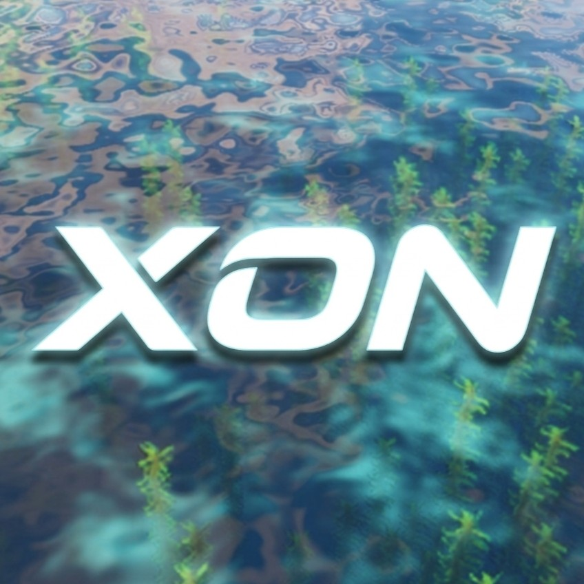
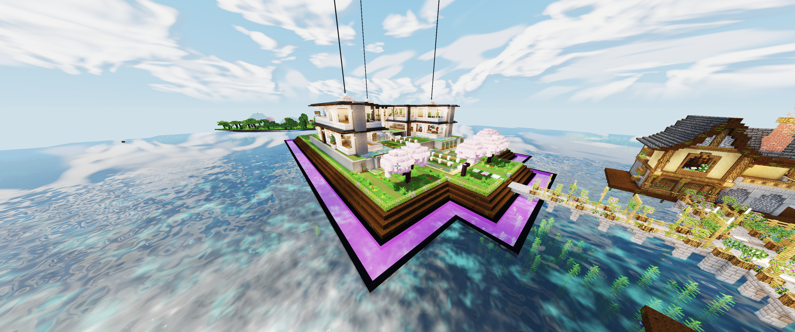
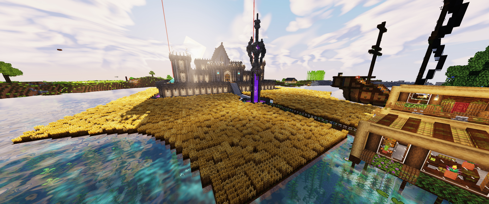

# XON Shader

### Beautiful worlds. Performance by design.

**Minecraft Java 26.3 · Iris + Sodium required · Free for personal play**

[Download on Modrinth](https://modrinth.com/shader/xon-shader) · [Report an issue](https://github.com/Danonymos/XON/issues/new/choose) · [Contribute](CONTRIBUTING.md) · [License](LICENSE)

XON brings warm directional light, sculpted clouds, organic water, and expressive atmosphere to Minecraft with a rendering pipeline built to keep costs under control. Its goal is simple: **a world you want to look at, with a frame rate you want to play at.**

Lower-end hardware is a design priority. Balanced delivers the intended visual experience; Speed removes selected heavier effects for players who put responsiveness first. Actual FPS depends on hardware, resolution, scene, mods, and settings. No controlled comparative benchmark is published here, and zero FPS loss is not claimed.

## The look

- **Light with character:** warm sunlight, cool readable shade, sun/moon cast shadows, ambient occlusion, and held-item light.
- **Living skies:** rounded procedural cumulus, high cirrus wisps, storm response, and changing golden-hour colors.
- **Organic water:** multi-scale waves, sky/cloud reflections, sun/moon glints, depth color, optional refraction, and underwater caustics.
- **Small details:** waving plants, selective ore/crystal emission, restrained bloom, authored color grading, and adjustable camera motion blur.
- **Distinct dimensions:** animated cellular lava in the Nether and flowing violet auroras in the End.

## Where the engineering goes

| Choice | Implementation |
| --- | --- |
| Bounded cast shadows | 1024-pixel map and 96-block range by default; two hardware-filtered receiver taps; entity/block-entity shadow rendering off. |
| Smaller effect buffers | Half-resolution bloom, localized sun rays, and refraction scene copy. |
| Focused sun shafts | Four shadow-map samples inside a cone near the sun. |
| Shared edge filtering | Depth-guided spatial AA in the final pass, without temporal history buffers. |
| Distance-aware detail | Water fine detail fades with distance; foliage motion runs in the vertex stage within a bounded range. |
| Experimental Boost | 85%/75% world rendering with spatial reconstruction and restrained sharpening. |

These are implementation choices, not measured speedup percentages. See [engineering notes](docs/ENGINEERING.md) for source pointers and tradeoffs.

## Pick your preset

| Preset | Purpose |
| --- | --- |
| **Balanced + Native** | Full default look, including shadows, procedural clouds, bloom, refraction, and caustics. |
| **Speed + Native** | Disables those effects while retaining directional lighting, ore emission, color grading, and edge AA. |
| **Boost Quality / Performance** | Experimental 85% / 75% rendering scale for GPU-limited situations, at a sharpness cost. |

Boost does not accelerate chunk generation or game simulation. The HUD stays at display resolution. Shader settings expose brightness, warmth, saturation, AO, shadows, water effects, and blur. Camera blur is on by default and can be disabled.

## Install

1. Use **Minecraft Java 26.3** with compatible **Fabric, Iris, and Sodium** versions. Both **Iris and Sodium are required**.
2. Download the runtime ZIP from [Modrinth](https://modrinth.com/shader/xon-shader) when the project is published.
3. Put it intact in your instance's `shaderpacks` folder.
4. Open **Video Settings → Shader Packs**, select XON, and apply it.
5. Start at **Balanced + Native**; try **Speed** on lower-end hardware.

The archive README names Iris 1.11.7 and Sodium 0.9.2 as the initial target setup. The author confirms Minecraft 26.3 with Iris + Sodium. Other Minecraft versions and OptiFine are unverified. This is a client shader; no server installation or extra PBR texture pack is required.

## Know the tradeoffs

Water reflects sky/clouds rather than buildings. Ore emission does not propagate colored light to nearby blocks. Clouds use layered heightfields rather than volumetric ray marching, and sunlight shafts use the shadow map rather than global ray tracing. Motion blur follows the camera, not independent moving objects.

Distant Horizons, Voxy, VR, Vulkan renderers, macOS, and modded dimensions are not certified. Bedrock Edition is not supported.

## Build from this source

The repository contains the complete packaged shader sources and bundled textures. To make a development pack, create a ZIP with `shaders/` and `LICENSE` at its root, then place that ZIP in `shaderpacks`. Alternatively, use a development folder containing those same root entries.

The original build tools and external verification reports mentioned in the archived pack README were not included in the supplied release ZIP. No shader compilation or in-game benchmark has been performed as part of this repository setup. File integrity has been checked against the supplied archive.

## Help improve XON

Found a problem or have a focused improvement? [Open an issue](https://github.com/Danonymos/XON/issues/new/choose) or read [CONTRIBUTING.md](CONTRIBUTING.md) before preparing a pull request. Include your setup and reproducible steps; performance reports should compare the same scene and settings.

## License

**Source available; all rights reserved except the explicit permissions in [LICENSE](LICENSE).**

Personal, non-commercial Minecraft gameplay and normal shader-setting adjustments are free. A narrow contribution exception permits GitHub forks and code changes solely to submit improvements to this official project. Standalone redistribution, competing packs, ports, asset/code reuse, and commercial use require prior written permission. Public source access is not an open-source license.

Screenshots show a customized Minecraft world. Builds and unrelated resource-pack/model assets shown are not included in XON.
