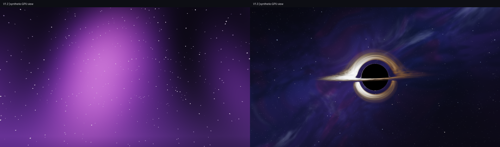
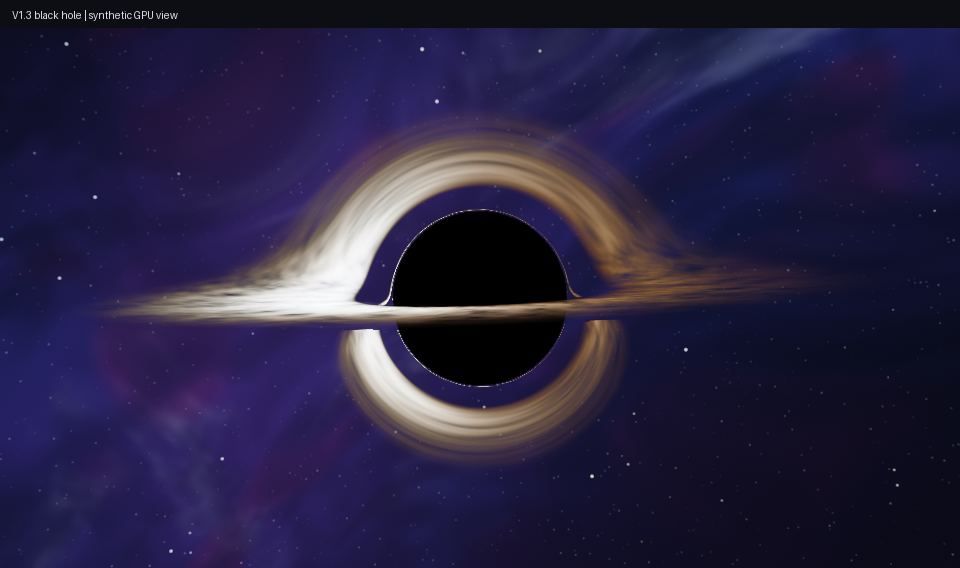
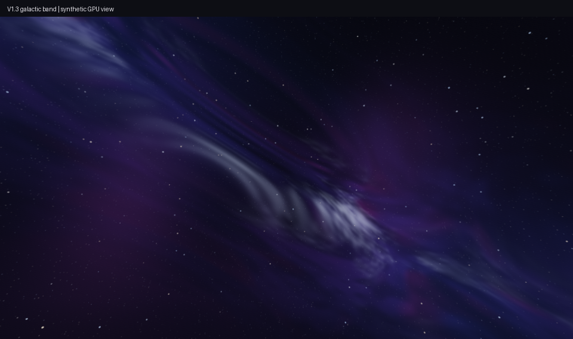
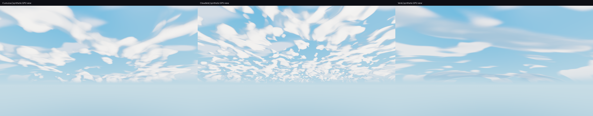
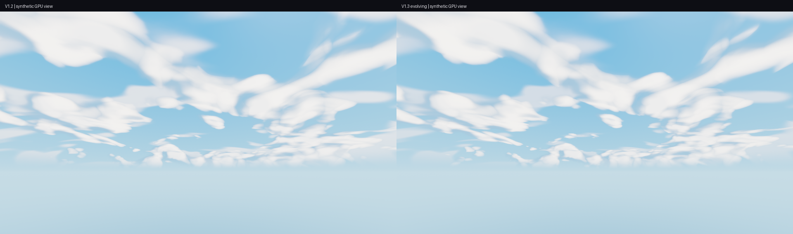
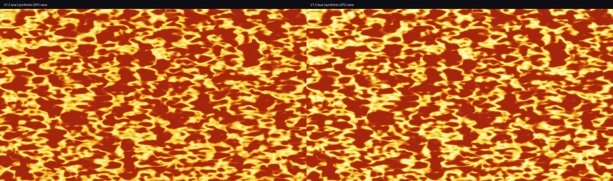

# V1.3 visual polish: GPU previews and measurements

## End draw-state correction, still V1.3

The initial isolated fragment tests disabled blending and missed two loader-level
interactions shown by live screenshots: the background was forced to blend
additively over existing colors, and End flashes rendered opaque galaxy quads.
The dimension-qualified blend override was not selected by the installed Iris
program-name lookup. The blanket sky-texture overrides are now removed so native
End background/translucent and celestial/additive states can differ correctly.
Overworld celestial blending in the installed client already matches the removed
blanket override.

In the End textured program, the documented
[blendFunc destination factor](https://shaders.properties/current/reference/uniforms/rendering/#blendfunc)
distinguishes native additive celestial flashes from the background cube.
Flash texture alpha, vertex intensity and blindness/medium gates are preserved.
No new image, pass, background lookup or version number is added.

`python tools/end_sky_pipeline_checks.py` executes the production vertex and
fragment shaders on a synthetic six-face cube and masked flash with real GPU
blend states. Eleven GPU aggregate cases and one property check pass. The original
forced-additive fixture retains 0.08 maximum background-color error; the corrected
native cube has zero. A zero-intensity old flash changes RGB by up to 3.886;
the corrected flash changes no RGB. Native Overworld celestial pixels remain
identical across the tested weather/media combinations, and both Boost guards pass.
These reproduce the failure mechanisms, not the exact captured Minecraft frame.
Reloading the corrected pack in-game is still needed to confirm the live result.

## Initial visual polish measurements

These images come from the production GLSL with controlled input rays and
textures, followed by the real bloom and final color passes. They are synthetic
diagnostics, not Minecraft screenshots or a claim of an exact reference match.

Reproduce with `python tools/visual_polish_checks.py`. The black-hole transfer
can be regenerated with `python tools/make_black_hole.py` (NumPy and Pillow).
The references were used for visual direction; no reference image is packaged.

On the RTX 5060 Ti, 960x540 RGBA32F target, 24 interleaved timer queries per
version and four draws per query, the observed medians were approximately:

| Isolated workload | V1.2 ms | V1.3 ms |
| --- | ---: | ---: |
| End sky | 0.0156 | 0.0314 |
| Overworld sky | 0.0528 | 0.0563 |
| Lava terrain | 0.0285 | 0.0288 |

The JSON report retains exact values and p95 scheduling spikes. Full-screen
coverage, resolution, driver clocks, desktop activity and other game work affect
these costs. They do not establish in-game FPS or identical performance.

The 15 new GPU cases cover the dark shadow and toggle, star contribution,
translation invariance, transparent lookup borders, medium handling, distinct
cloud formations, motion/storm behavior, cycle/reset continuity and lava glow.
The tested lava field produces about 1.72x the extracted bloom energy; this is
not a universal display-brightness ratio. Lava Glow zero exactly restores V1.2
lava output in that fixture. All existing regression assertions remain in force.

The black-hole source integrator measured a maximum relative null-geodesic
invariant error of 2.49e-12. Interpolation, 8-bit texture encoding and simplified
disk radiation limit the final image's physical accuracy. The model has fixed
inclination and no spin, evolving gas simulation or scene-geometry lensing.
